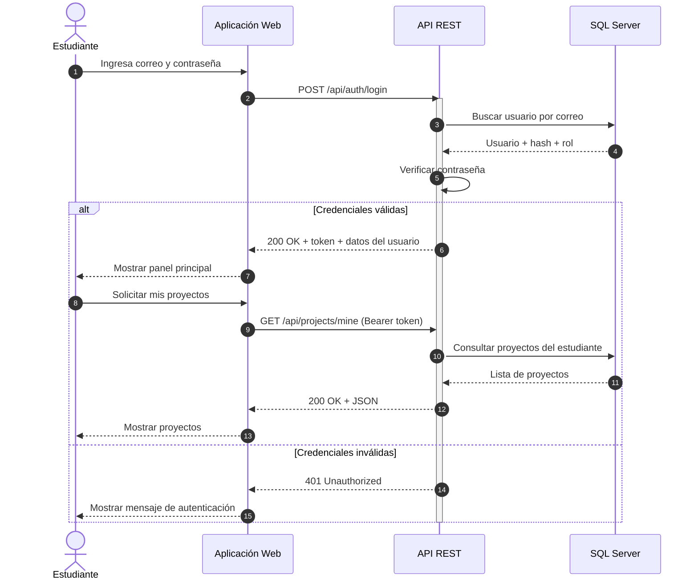
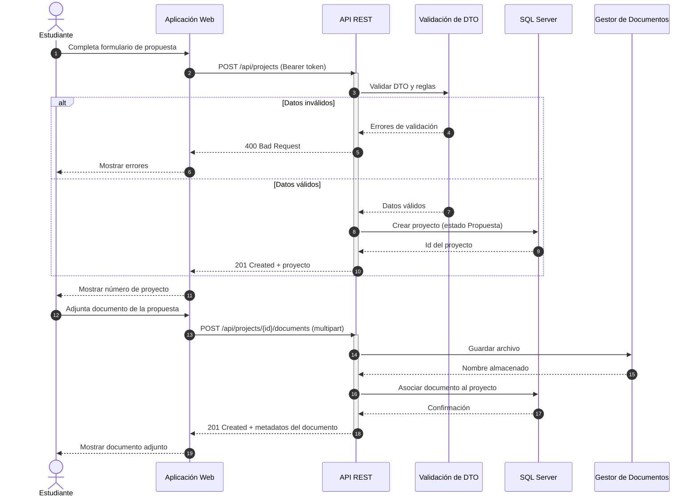
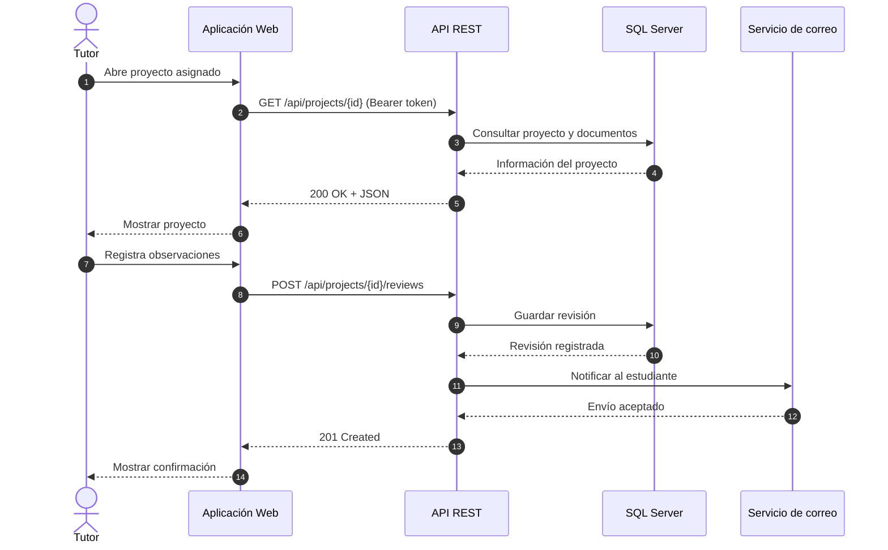
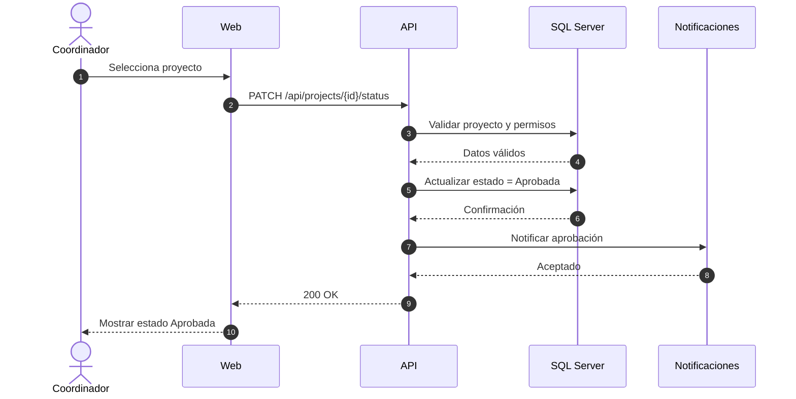

# Sistema de Gestión de Proyectos de Graduación UNI

Plataforma web para **registrar, revisar, aprobar y dar seguimiento a proyectos de graduación** de la Universidad Nacional de Ingeniería (UNI).

Proyecto de la asignatura *Diseño de Sistemas en Internet* (Ingeniería de Sistemas). Documenta la arquitectura con el **Modelo C4** (niveles 1 y 2), **diagramas de secuencia** y un enfoque **API-First**, usando **Mermaid** versionado junto al código.

## Tecnologías

ASP.NET Core 8 Web API · C# · Entity Framework Core · SQL Server · JWT · Swagger/OpenAPI · Mermaid · GitHub

## Arquitectura

### C4 Nivel 1 – Contexto

Muestra quién usa el sistema y con qué sistemas externos se comunica.

```mermaid
C4Context
title Sistema de Gestión de Proyectos de Graduación UNI - Contexto

Person(estudiante, "Estudiante", "Registra y da seguimiento a su proyecto de graduación")
Person(tutor, "Tutor", "Revisa proyectos, registra observaciones y valida avances")
Person(coordinador, "Coordinador", "Administra asignaciones, estados y seguimiento académico")
Person(admin, "Administrador", "Administra usuarios, roles y catálogos")

System(uni, "Sistema de Gestión de Proyectos de Graduación UNI",
       "Plataforma web para registrar, revisar, aprobar y dar seguimiento a proyectos de graduación")

System_Ext(email, "Servicio de correo institucional",
           "Envía notificaciones académicas")
System_Ext(storage, "Almacenamiento de documentos",
           "Conserva documentos entregados por los estudiantes")

Rel(estudiante, uni, "Registra propuestas, entrega documentos y consulta avances")
Rel(tutor, uni, "Revisa proyectos y registra observaciones")
Rel(coordinador, uni, "Gestiona proyectos, tutores y estados")
Rel(admin, uni, "Administra usuarios y catálogos")

Rel(uni, email, "Envía notificaciones")
Rel(uni, storage, "Almacena y recupera documentos")

```

### C4 Nivel 2 – Contenedores

Muestra las aplicaciones y almacenes de datos que forman el sistema. La aplicación web **nunca** habla directo con SQL Server: todo pasa por la API.

```mermaid
C4Container
title Sistema de Gestión de Proyectos de Graduación UNI - Contenedores

Person(estudiante, "Estudiante", "Usuario académico")
Person(tutor, "Tutor", "Docente tutor")
Person(coordinador, "Coordinador", "Responsable académico")

System_Boundary(uni, "Sistema de Gestión de Proyectos de Graduación UNI") {
    Container(web, "Aplicación Web", "React / Angular / JavaScript",
              "Interfaz para estudiantes, tutores y coordinadores")
    Container(api, "API REST", "ASP.NET Core Web API / C#",
              "Autenticación, reglas de negocio y servicios HTTP")
    ContainerDb(db, "Base de Datos", "SQL Server",
                "Usuarios, proyectos, revisiones, estados y catálogos")
    Container(files, "Gestor de Documentos", "Almacenamiento de objetos",
              "Documentos de propuestas, avances y defensa")
}

System_Ext(email, "Correo institucional", "SMTP / proveedor de correo")

Rel(estudiante, web, "Usa", "HTTPS")
Rel(tutor, web, "Usa", "HTTPS")
Rel(coordinador, web, "Usa", "HTTPS")

Rel(web, api, "Consume API REST", "HTTPS/JSON")
Rel(api, db, "Lee y escribe", "EF Core / SQL")
Rel(api, files, "Sube y recupera documentos", "HTTPS")
Rel(api, email, "Envía notificaciones", "SMTP/API")

```

### Secuencia – Login y consulta de proyectos



### Secuencia – Registrar propuesta de proyecto



### Secuencia – Revisión del tutor



### Secuencia – Aprobar proyecto (coordinador)



> Los diagramas fuente (`.mmd`) están en [`docs/diagramas`](docs/diagramas). Se pueden abrir y editar en <https://mermaid.live/>.

## Contrato de la API (API-First)

| Método | Endpoint | Rol requerido | Éxito | Errores principales |
|---|---|---|---|---|
| POST | `/api/auth/login` | Público | 200 | 400, 401, 429 |
| GET | `/api/projects/mine` | Autenticado | 200 | 401 |
| GET | `/api/projects/{id}` | Autenticado (autor, tutor asignado, coordinador o admin) | 200 | 401, 403, 404 |
| POST | `/api/projects` | Estudiante | 201 | 400, 401, 403 |
| POST | `/api/projects/{id}/documents` | Estudiante autor | 201 | 400, 401, 403, 404 |
| POST | `/api/projects/{id}/reviews` | Tutor asignado | 201 | 400, 401, 403, 404 |
| PATCH | `/api/projects/{id}/status` | Coordinador / Administrador | 200 | 400, 401, 403, 404 |
| PATCH | `/api/projects/{id}/tutor` | Coordinador / Administrador | 200 | 400, 401, 403, 404 |

**Estados del proyecto:** `Propuesta → Revision → Aprobada → EnDesarrollo → Defensa → Cerrada` (desde `Revision` también se puede volver a `Propuesta` para correcciones).

### Ejemplo: login

```http
POST /api/auth/login
Content-Type: application/json

{ "email": "estudiante@uni.edu.ni", "password": "********" }
```

```json
{ "userId": 1, "email": "estudiante@uni.edu.ni", "role": "Estudiante", "token": "<JWT>" }
```

## Cómo ejecutarlo

Guía completa en **[docs/EJECUCION_PASO_A_PASO.md](docs/EJECUCION_PASO_A_PASO.md)**. Resumen:

```bash
# 1. (Opcional) crear la base con el script database/01_crear_base_de_datos.sql
# 2. Configurar secretos (no se suben al repositorio)
cd src/GraduacionUni
dotnet user-secrets set "Jwt:Key" "<clave-aleatoria-de-32-o-mas-caracteres>"
# 3. Ejecutar
dotnet run --launch-profile https
# 4. Abrir https://localhost:7080/swagger
```

Usuarios de demostración (solo en Development), contraseña `Uni2026*Dev`:
`estudiante@uni.edu.ni`, `tutor@uni.edu.ni`, `coordinador@uni.edu.ni`, `admin@uni.edu.ni`.

## Estructura

```text
GraduacionUni/
├── README.md
├── database/01_crear_base_de_datos.sql
├── docs/
│   ├── EJECUCION_PASO_A_PASO.md
│   └── diagramas/*.mmd
└── src/GraduacionUni/
    ├── Api/            Controllers, Extensions
    ├── Application/    DTOs, Services (reglas de negocio)
    ├── Domain/         Entities (User, Project, Review, ProjectDocument)
    ├── Infrastructure/ Persistence (EF Core), Security (JWT), Storage, Notifications
    └── Program.cs
```

## Decisiones técnicas

- **API-First:** el contrato HTTP se definió antes que la interfaz; Swagger/OpenAPI lo expone y permite probarlo.
- **DTOs:** las entidades de base de datos nunca se devuelven directamente.
- **Inyección de dependencias** y controladores delgados: la lógica vive en `Application/Services`.
- **Abstracciones para lo externo:** `IDocumentStorage` (gestor de documentos) e `INotificationService` (correo) se pueden reemplazar por Azure Blob/S3 o SMTP sin cambiar la API.
- **Seguridad:** contraseñas con hash (`PasswordHasher`), JWT con expiración, límite de intentos de login por IP, claves fuera del repositorio (`user-secrets`), validación de extensión y tamaño en la carga de archivos.

## Pendiente para producción

Pruebas automatizadas, migraciones de EF Core, envío real de correo (SMTP), almacenamiento de documentos en un servicio externo, auditoría, observabilidad, bloqueo de cuenta tras intentos fallidos y gestión de secretos en un servicio dedicado.
